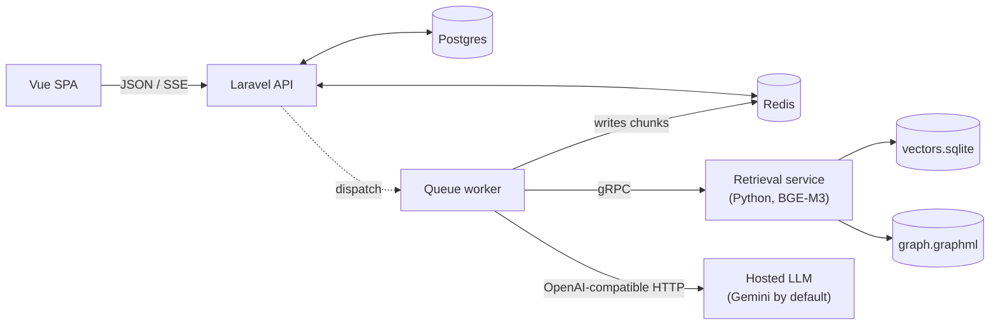
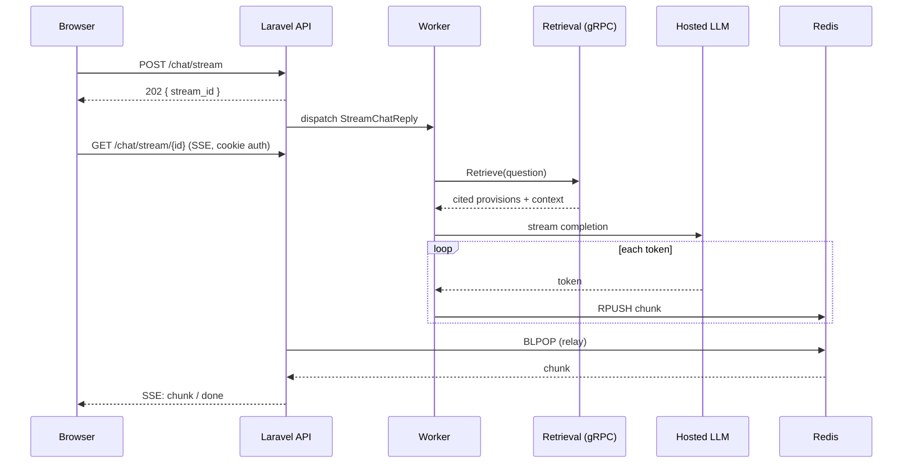
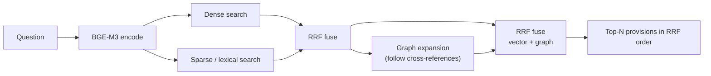

# GraphRAG for Macedonian Legislation

A question-answering platform over a corpus of Macedonian law. You ask a question
in Macedonian; the system retrieves the relevant **statutory provisions**, cites
them, and presents a short generated summary as a clearly subordinate aid.

The product framing is deliberate and load-bearing. The primary output is the
list of cited articles — the tool is built for legal practitioners who read the
provisions themselves. The generated prose sits underneath that list, styled and
labelled as secondary, so it is never mistaken for the answer. **This is not a
legal-advice tool**, and the UI is designed to keep that obvious: it surfaces
sources first and the model's words second.

> The bundled legal documents (terms, privacy notice) are **drafts pending
> professional review**, not finished legal instruments.

---

## What it is, concretely

The corpus is **10 Macedonian laws** — public procurement, labour relations,
personal-data protection, free access to public information, general
administrative procedure, administrative servants, public-sector employees,
copyright, publishing, and culture — parsed into **1,831 text chunks** and a
**citation graph of 1,410 articles joined by 945 cross-references**.

Retrieval is hybrid and the graph is real, but the "GraphRAG" label deserves a
caveat up front (see [Retrieval](#retrieval)): the graph edges are **explicit
statutory cross-references parsed from the text** ("as defined in Article 96…"),
not LLM-extracted entity relationships. It is a citation graph, not a knowledge
graph.

---

## Architecture



- **Laravel API + Vue SPA** — the web tier. Sanctum cookie sessions, Postgres for
  data and the queue, Redis for the streaming side-channel.
- **Queue worker** — runs the one long job, `StreamChatReply`, off the request
  thread.
- **Retrieval service** — a standalone **Python gRPC** service holding BGE-M3, the
  vector matrix, and the citation graph in memory. Deployed on the same host as
  the app to save cost; splitting it onto its own box is an env change
  (`AI_RETRIEVAL_URL`), not a rewrite.
- **Generation** — by default a **hosted OpenAI-compatible endpoint** (Gemini's
  compatibility layer). An **opt-in local llama.cpp service** is kept as an
  offline / rate-limited fallback behind a Compose profile.

### The request lifecycle, and why it's shaped this way

A streamed answer is not a single request/response. Generation takes seconds and
can fail mid-flight, so the browser gets an immediate handle and subscribes to a
separate event stream.



1. `POST /api/v1/chat/stream` persists the user message, dispatches the job, and
   returns **`202` with a `stream_id`** — it does not wait for the answer.
2. The worker calls retrieval over gRPC, then streams generation, **`RPUSH`-ing
   each token onto a Redis list** keyed by the stream id.
3. The browser opens an **SSE** connection to `GET /api/v1/chat/stream/{id}`. The
   relay `BLPOP`s that list and forwards `status` / `chunk` / `done` / `error`
   events.

A **Redis list**, not pub/sub, is what buffers tokens produced before the browser
finishes connecting — pub/sub would drop them.

**Why SSE forced cookie sessions over JWT.** The stream is delivered with
`EventSource`, and `EventSource` cannot set an `Authorization` header — it sends
only cookies. So the streaming endpoint authenticates on the **same-origin Sanctum
session cookie**, and the whole SPA follows suit rather than splitting auth across
two schemes. Bearer tokens still exist for programmatic API access; the browser
path is cookie-based because the transport left no choice.

The relay also carries two independent silence budgets — a generous **first-token**
window (retrieval + prefill) and a tight **between-token** window — so a worker
that dies without running its failure hook (a `SIGKILL`, an OOM, a deploy
mid-answer) surfaces a clean error in seconds instead of hanging the browser.

---

## Retrieval

Each question runs through a hybrid pipeline:



- **BGE-M3** produces both a dense vector and lexical-sparse weights from one
  pass; dense and sparse searches run over `vectors.sqlite` (1,831 chunks).
- **Reciprocal Rank Fusion** merges the rankings — chosen over a weighted score
  sum because the signals aren't on a shared scale (cosine, unbounded lexical dot
  products, and a graph with no similarity score at all). Rank position is the one
  thing they agree on.
- **Graph expansion** takes the strongest hits and pulls in the articles they
  cross-reference, so a provision that only *cites* the match still competes.
- The fused top-N is returned **in RRF order**.

**On the word "GraphRAG."** The graph is genuine and it does real work — but its
edges are explicit statutory cross-references parsed from the legislation, not
relationships an LLM inferred. If you know the term, calibrate accordingly: this
is retrieval augmented by a **citation graph**, not by an extracted knowledge
graph.

---

## The evaluation harness

The part most RAG demos skip, and the reason every decision below has a number.

`tests/eval/questions.yaml` is a **29-question set** whose questions and expected
answers were **authored by a lawyer**. The expected *source articles* were derived
afterwards — from retrieval output cross-checked against the statutory text — and
several rows are marked low-confidence pending verification. They are a working
ground truth, not an authoritative citation index, and the scores below should be
read with that caveat. `scripts/eval_retrieval.py` runs the questions against the
live retrieval service and scores **recall@k with zero LLM calls** — it never
touches generation, so it costs no API quota and isolates retrieval quality from
the model's phrasing.

Five of the 29 questions (≈17%) are marked `expected_refusal: true`: their answers
are agency guidance or interpretation, **not present in the statute**. The correct
behaviour there is to refuse, so a fluent answer is a failure, not a success.

Because the retrieval service is deterministic, a run is reproducible and two runs
`compare` cleanly. That is what made the reranker decision below an experiment
rather than an opinion.

---

## Engineering decisions, with numbers

Every figure here comes from a run in `tests/eval/results/`, `docker stats`, or a
service log — see [Verification](#verification-notes) for which is which.

### Generation moved off-box to a hosted API

Local Qwen on CPU via llama.cpp is **prefill-bound at ~90s** (the context, not the
answer length, dominates), and answered end-to-end in minutes. Moving generation
to a hosted OpenAI-compatible endpoint took a full answer to **a few seconds**
(≈180s → ≈6s end to end). The local service is retained behind a Compose profile
for offline / rate-limited use. Swapping between them is a driver config change;
the `ChatService` and controllers never move.

### The cross-encoder reranker was removed

A bge-reranker-v2-m3 cross-encoder used to re-score the fused pool. Measurement
retired it. On the 29-question set (same run for both):

| | Reranker (pool 16 → top 6) | No reranker (pool 24 → top 16) |
|---|---|---|
| recall of the returned set | 0.77 | **0.81** (recall@16) |
| recall at an equal top-6 window | 0.77 | 0.60 |
| per-query latency (median) | **~4 s** | **~0.14 s** |
| retrieval RAM | 4.00 GiB | **2.96 GiB** |

Recall is essentially flat across the change (~0.8 either way): the reranked
config scored 0.77 on the latest same-day A/B and 0.81 on earlier same-set runs,
and the no-reranker top-16 scores 0.81 — so removing the reranker does not cost
recall of the returned list. The cross-encoder *does* order a short list better
(0.77 vs 0.60 at top-6), but it was only **reordering provisions already inside the
RRF top-16**; returning that top-16 directly matches it. Since the product shows a
scannable list of provisions (not a single best answer), that reordering bought the
user nothing, while costing ~30× latency and ~1 GiB of resident memory. So it came
out. `torch` and `onnx` backends are kept behind a flag for the eval harness to
switch back and compare.

### The result: a footprint that fits a 4 GB box

The whole stack now runs in **3.17 GiB** (`docker stats`, warm). Two moves got it
there: making local generation opt-in removed a **~2 GiB** GGUF from the default
deployment, and dropping the reranker freed **~1 GiB**. Warm retrieval is
**~0.1–0.3 s**; `rerank=0` on every query, and BGE-M3 encoding (~0.28 s cold on
the first pass) is now the entire cost.

### Concurrency

Eight concurrent users on a single queue worker complete in **~4 s each**, with host
CPU peaking around **26%**. Retrieval is ~0.3 s and generation ~2 s, so jobs drain
fast enough that queuing is not perceptible at this scale. One observed failure
during testing was an **upstream Gemini timeout** (`status: null`, connection never
returned) rather than a local limit; the reliability layer surfaced clean terminal
errors, left no orphaned Redis state, and did not double-bill.

---

## What doesn't work

A list of only wins is less trustworthy than one that names the edges.

- **Retrieval has genuine misses.** With the reranker gone, four questions
  retrieve *none* of their expected articles even in the top 16 (Q2, Q9, Q11,
  Q26). Q2 and Q9 are documented in the question file as clean retrieval gaps — a
  vocabulary mismatch (Q2) and a provision that never appears in 40 candidates
  (Q9); those are **chunking / embedding** failures a wider window can't fix. Q11
  is a different case: the cross-encoder used to rescue it (it surfaced
  `ZAKON-ZA-JAVNITE чл. 6` to rank 1), so the honest miss count rose from three
  (reranked) to four when the reranker came out — the cost paid for the latency
  and memory it saved.
- **Part of the corpus genuinely can't answer part of the questions.** ~17% of the
  set asks for agency guidance rather than statute. Correct behaviour is refusal,
  and that is what the eval expects.
- **The abstention signal was lost with the reranker.** The old rerank score was a
  clean confidence signal — unanswerable questions scored far below answerable
  ones, so the system could refuse *without* calling the LLM. RRF fused scores do
  **not** carry that information: they are rank-derived and bounded, and on the
  eval set the unanswerable questions' top-1 scores fall entirely inside the
  answerable range (several at the exact single-signal floor). Refusal now rests on
  the **system prompt alone**. This was a real capability, and it is gone; the
  cheapest candidate to restore it (thresholding the raw dense cosine the pipeline
  currently discards) is unproven.
- **Retrieval is a separate service on the same host.** That is a cost decision,
  not an architectural limit — moving it to its own instance is a change to
  `AI_RETRIEVAL_URL`, nothing more.

---

## Running it

Requires Docker and (for the hosted generation path) a Gemini API key.

**First-time setup**

```bash
bash scripts/fetch-artifacts.sh                          # verify graph + vector artifacts
export APP_KEY="$(php artisan key:generate --show)"      # required by compose
# Point at hosted generation (default, recommended):
#   in your environment or .env:  AI_DRIVER=openai_compatible  LLM_API_KEY=<key>
docker compose up -d
```

**Mint an invite code** (open signup is deliberately closed — this is the only way
to register):

```bash
docker compose exec laravel php artisan invitations:create --note "reviewer"
```

Register in the SPA with that code, then log in.

**Offline / fallback generation** (local llama.cpp instead of the hosted API):

```bash
docker compose --profile local-llm up -d    # starts the generation service
# and set AI_DRIVER=grpc
```

**Tests**

```bash
composer test                                            # Laravel: feature + unit (Pest)
# Python services (torch CPU wheel + requirements, then pytest):
cd services/retrieval && python -m pytest tests -q
cd services/generation && python -m pytest tests -q
```

**The two harnesses**

```bash
# Retrieval quality — recall@k, no LLM calls, no API quota.
# Use the retrieval service's own venv (already has grpc + protobuf + the stubs):
#   Linux/macOS: ./services/retrieval/.venv/bin/python
#   Windows:     ./services/retrieval/.venv/Scripts/python.exe
PY=./services/retrieval/.venv/bin/python           # Windows: .../Scripts/python.exe
"$PY" scripts/eval_retrieval.py run --label mine
"$PY" scripts/eval_retrieval.py compare A.json B.json

# Streaming reliability against the live stack (idempotency, retries, worker
# death, first-chunk timeout):
scripts/verify-reliability.sh
```

---

## Verification notes

Numbers in this README trace to: the two eval runs in `tests/eval/results/`
(`*readme-reranked`, `*readme-none`) for recall and per-query latency; `docker
stats --no-stream` for the 3.17 GiB stack and 2.96 GiB retrieval figures; the
retrieval startup log for the 1,410-article / 945-cross-reference graph and 1,831
chunks; and `vectors.sqlite` for the 10-law / 1,831-chunk corpus. The generation
≈180s → ≈6s figure is the maintainer's end-to-end measurement across the migration
(the ~90s local prefill floor is documented in `config/ai.php`); it was not
re-timed here.
